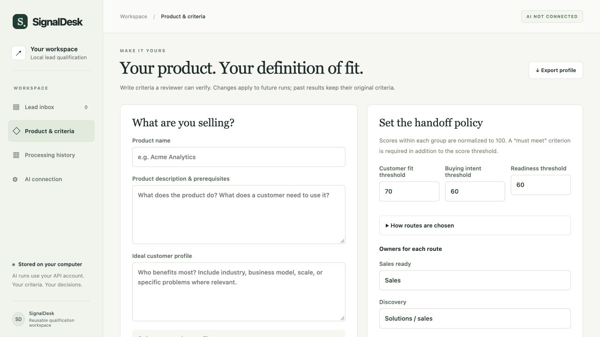
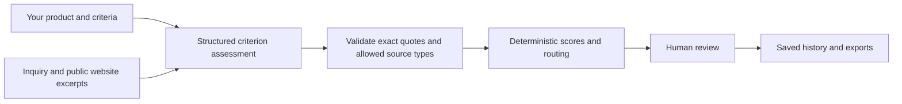

# SignalDesk

**Qualify your own inbound leads against your own product, ideal customer profile, and handoff criteria.**

SignalDesk is a reusable, local application for GTM and revenue teams. Import leads, gather public website evidence, use an AI model to assess your criteria, review the recommendation, and export the next steps. It starts with an empty workspace; example data is optional.



## Start in two minutes

1. Clone [kotharisaahil/signaldesk](https://github.com/kotharisaahil/signaldesk) or choose **Code → Download ZIP** on GitHub and extract it.
2. Install Python 3.9 or later if you do not already have it.
3. Open a terminal in the project folder and run:

```sh
python3 -m app.server
```

To clone and start from a terminal:

```sh
git clone https://github.com/kotharisaahil/signaldesk.git
cd signaldesk
python3 -m app.server
```

4. Open **http://127.0.0.1:8766** in your browser.
5. In **Product & criteria**, enter your product, prerequisites, and ideal customer profile. Adjust the criteria and save.
6. Add a lead or import your CSV.
7. In **AI connection**, enter your own OpenAI API key. Select a lead and run qualification, then inspect its evidence and save your review.

There are **no Python packages, JavaScript dependencies, or build steps to install**. On Windows, use `python` instead of `python3` if needed. Keep the terminal running while using the app; Ctrl+C stops it. If the port is occupied, use `python3 -m app.server --port 8770` and open http://127.0.0.1:8770.

An API key is only needed for AI assessment. Manual evidence assessment, website fetching, local storage, review, and exports work without one. The application does not substitute example results when a connection is missing or fails. API usage is billed to the key owner's provider account.

## What someone can actually do with it

- **Configure a product:** 3–12 criteria across customer fit, buying intent, and implementation readiness. Set weights, mandatory criteria, thresholds, and route owners. Import/export the profile as JSON.
- **Import real leads:** upload a CSV of up to 100 rows, preview validation, and skip exact duplicates. Or enter one inquiry at a time.
- **Research a company:** fetch the supplied public HTTPS website and up to two relevant same-site pages, subject to robots rules and readable content. Save excerpts, URLs, and retrieval times.
- **Run AI qualification:** process 1–20 leads at a time with a real OpenAI Responses API integration and structured output. Review progress and failures, cancel remaining work, and preserve completed results.
- **Inspect evidence:** see a status and quoted source for each criterion. Unsupported citations become unknown. Public website text cannot establish private buying intent or implementation readiness.
- **Make a human decision:** confirm a route or override it with a reason. Previous runs, criteria, and reviewer decisions remain available. Changed criteria mark older results for requalification.
- **Take results elsewhere:** export a spreadsheet-ready CSV, full result/evidence JSON, or an individual Markdown account brief. A command-line interface supports scripts.

## Bring your leads

CSV column names are `company`, `website`, and `inquiry`. A company needs at least a website or inquiry; both are preferable. Extra columns are ignored. Use UTF-8, quote fields containing commas or newlines, and keep files below 1.5 MB. Company names may have 120 characters and inquiry notes 12,000 characters.

```csv
company,website,inquiry
Your prospect,https://prospect.example,"We want to evaluate your product. Our operations team owns the project."
```

The `.example` address above is illustrative; replace it with the actual company site. Download the CSV template inside the app, or adapt [examples/leads.csv](examples/leads.csv). The optional examples are fictional and explicitly labeled; they never load automatically.

## How decisions work



The model assesses evidence; code calculates scores and routes. Each group's weights normalize to 100. Met criteria contribute points, explicitly unmet criteria do not, and unknown criteria widen the score range. Display rounding never changes the decision. Scores are heuristics, not conversion probabilities.

Routing precedence:

1. Conflicting evidence → **Review needed**.
2. A mandatory fit criterion fails, or even the upper fit score misses the threshold → **Not a fit**.
3. Customer fit remains unestablished → **Review needed**.
4. Fit passes but stated intent fails → **Nurture**.
5. Intent or readiness remains insufficient → **Discovery**.
6. All required groups pass → **Sales ready**.

A citation check proves that quoted words appear in the supplied source. It does **not** independently prove the source is true or that the model interpreted the quote correctly. Review the evidence before acting. Inquiry notes should distinguish a prospect's statements from your assumptions.

## AI connection, cost, and data

The default model is `gpt-4.1-mini`; another model must support the Responses API with strict structured outputs. Change its ID under AI connection. The integration uses [OpenAI structured outputs](https://developers.openai.com/api/docs/guides/structured-outputs?api-mode=responses).

Keys entered in the UI are held in the local Python process's memory, never written to the workspace database or returned to the browser. Reconnect after restarting. Alternatively, provide `OPENAI_API_KEY` through your environment; `OPENAI_MODEL` sets the initial model. A saved model setting takes precedence in the UI. The app does not read `.env` files automatically. Do not put credentials in a product profile, CSV, Git commit, or screenshot.

Before each UI batch, confirm that the selected company names, inquiries, product profile, and researched excerpts may be sent to OpenAI. Requests use `store: false`; this does not override the provider's own retention policies. Website research sends requests directly to the websites supplied. Importing and manual assessment make no model requests.

Each successful AI result records model, prompt version, input/output tokens, and an approximate cost. The default-model reference price is $0.40 per million input tokens and $1.60 per million output tokens, checked against the [model documentation](https://developers.openai.com/api/docs/models/gpt-4.1-mini) on October 7, 2026. For example, 5,000 input plus 1,000 output tokens is approximately $0.0036 at those rates. Prices may change; discounts, failed calls, and other models are not priced by the app. This is not a spending cap or provider bill.

There are no automatic paid retries. Account, model-access, or quota errors skip remaining batch items. Cancel stops future items, but an in-flight request may complete and incur charges. Interrupted jobs do not resume automatically after restart.

## Storage and deployment

Your data stays in `.data/workspace.db`, except for explicitly requested website and AI calls. This SQLite file contains inquiries, source text, profiles, results, and review history. It is not encrypted by the app; protect it like your source lead data. The database and local secrets are excluded from version control.

For a separate product/workspace:

```sh
python3 -m app.server --port 8770 --db /path/to/separate-workspace.db
```

Stop the app before copying the database for a backup. JSON/CSV exports are reports, not full database restore files. A new database path creates an empty workspace. The old demo database, if present, is left separate.

The server binds only to `127.0.0.1`. This release is a **single-user local tool**, with host/origin checks and a session request token, not a public multi-user service. A GitHub visitor runs their own copy. Public hosting would require authentication, access controls, deployment hardening, and a separate data model.

## Command-line use

Run from the project folder. Profile JSON can be exported from the UI; the supplied example can be adapted.

```sh
python3 -m app.cli configure examples/product-profile.json
python3 -m app.cli import examples/leads.csv
python3 -m app.cli list
# With OPENAI_API_KEY already configured privately in your environment:
python3 -m app.cli run --pending --limit 5 --inquiry-only --allow-provider
python3 -m app.cli export results.csv
```

Those configure/import commands intentionally use fictional examples; replace their paths with your own files. Omit `--inquiry-only` to enable website research. Use repeated `--lead ID` options instead of `--pending` for specific leads. Pass `--db PATH` before the subcommand for a separate workspace. CLI runs save qualification history but do not appear as UI batch jobs. Existing export files require `--overwrite`. Store real exports outside the repository or in the ignored `exports/` directory.

## Verification and limitations

```sh
python3 -B -m unittest discover -s tests -v
```

The automated suite uses disposable databases, local HTTP servers, and mocked provider responses: no API key or paid calls. See [verification results](docs/evaluation.md) and [the case study](docs/case-study.md).

Live public website retrieval has been smoke-tested. **A real paid model call has not yet been verified in this development environment because no API key was available.** Contract tests verify request construction, parsing, refusal/error handling, and evidence validation. They do not establish real-world model accuracy. Independent labeling, precision/recall, conversion lift, and time savings remain unmeasured.

Research cannot access logged-in pages, render JavaScript sites, bypass robots restrictions, or enrich personal contacts. It is bounded to three pages per lead, not an exhaustive company investigation. Missing evidence is surfaced. There is no CRM sync, outbound email, lead deletion/editing UI, or multi-user sharing yet. Add a corrected inquiry as a new input, or use a separate workspace.

## Project map

| Path | Responsibility |
|---|---|
| `app/server.py`, `app/static/` | Local HTTP API and browser interface |
| `app/engine.py` | Product policy, citation validation, scores and routes |
| `app/research.py` | Bounded public HTTPS research |
| `app/provider.py` | Live OpenAI integration |
| `app/workspace.py` | SQLite persistence, imports, exports and briefs |
| `app/pipeline.py` | Jobs, cancellation, evidence flow |
| `app/cli.py` | Scriptable interface |
| `tests/test_reusable.py` | Current application tests |
| `examples/` | Optional fictional profile and leads |
| `app/legacy_server.py`, `app/qualification.py`, `data/` | Earlier demo retained for regression checks |

The legacy fixture report is archived separately and is not a benchmark for this version. AI-assisted development was used for implementation, tests, and documentation. See [LICENSE](LICENSE) for reuse terms.
